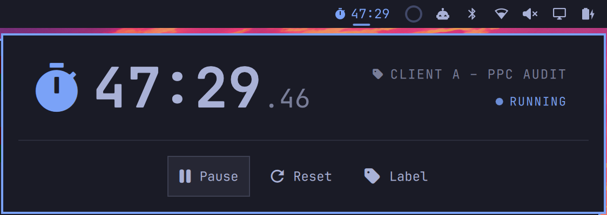

# Omacrono

Omacrono is a labeled stopwatch for the [Omarchy](https://omarchy.org/) bar.
Start it, give it a label like "Client A – PPC audit", and see at a glance how
long you've been on it.



It is based on [Omadoro](https://github.com/brianblakely/omadoro) by Brian
Blakely, with the Pomodoro phases replaced by a count-up timer and labels.

## Install

```bash
omarchy plugin add https://github.com/samuevelez-cyber/omacrono.git --enable --yes
```

No extra packages are needed.

## Use

At zero, the bar shows a stopwatch icon. Once started it shows the elapsed time
in your theme's accent color (faded while paused).

| On the bar icon | Action         |
| --------------- | -------------- |
| Left-click      | Open the panel |
| Right-click     | Start / pause  |
| Middle-click    | Reset to zero  |

The panel shows the time (with hundredths), the current label and status, and
three buttons: Start/Pause, Reset and Label.

### Labels

Click the label (or the Label button) to name what you're timing. The box opens
empty and lists every label you've used, newest first; typing filters it
(labels that start with the text come first).

- Up/Down highlights a label, Tab fills it in, Enter uses the highlighted label
  or what you typed.
- Typing a known label in another case keeps its original spelling.
- Enter on an empty box keeps the current label, Delete on an empty box removes
  it, Escape cancels.
- Changing the label while running doesn't touch the counter.
- **At zero, choosing a label starts the stopwatch**, counting from the moment
  the label box opened. The panel and the bar count along while you type.

Reset sets the counter back to zero and clears the label. A running stopwatch keeps
counting across bar reloads and logouts.

### Keyboard controls

With the panel open:

- Use the arrow keys or `h`, `j`, `k`, and `l` to select a button.
- Press Enter or Space to activate it.
- Press Escape to close the panel.
- Press Tab or Shift+Tab to move between bar panels.

## Shortcuts (optional)

Omacrono doesn't change your keybindings. To start/pause and open the panel
from anywhere, add these lines to `~/.config/hypr/bindings.lua` (pick any keys
that are free on your system):

```lua
o.bind("SUPER + ALT + T", "Stopwatch start/pause", "omarchy-shell -q s.omacrono toggle")
o.bind("SUPER + SHIFT + ALT + T", "Stopwatch panel", "omarchy-shell shell toggle s.omacrono")
```

Scripts can use the same commands:

```bash
omarchy-shell s.omacrono toggle
omarchy-shell s.omacrono reset
omarchy-shell s.omacrono label "Client A"
omarchy-shell s.omacrono status
```

## Data

- `~/.local/state/omarchy/omacrono.json`: the current stopwatch and label.
- `~/.local/state/omarchy/omacrono-history.json`: each finished stretch of
  labeled time, kept for 90 days. The panel only uses it for label suggestions.

Nothing leaves your computer.

## Update

```bash
omarchy plugin update s.omacrono
```

## Uninstall

```bash
omarchy plugin remove s.omacrono
```

To also delete its saved data:

```bash
rm ~/.local/state/omarchy/omacrono.json ~/.local/state/omarchy/omacrono-history.json
```

## Development

Run the tests with `tests/all.sh`. After editing plugin files, run
`omarchy restart shell`: hot reloads keep the old service running.

## License

MIT. See [LICENSE](LICENSE).
